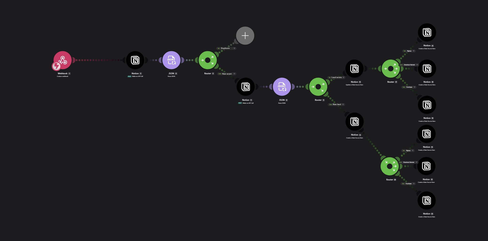
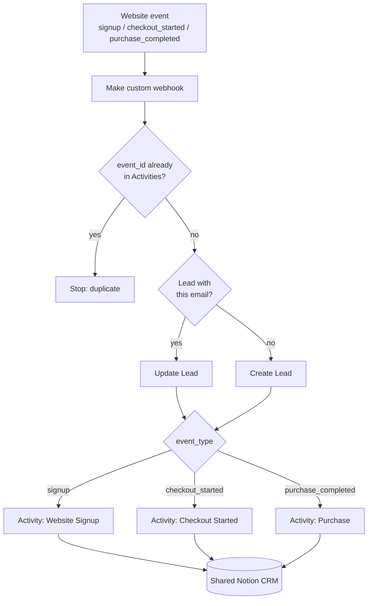

# Jackmonx — Website-to-CRM Lifecycle Events Engine

**GTM Engineering case study: an event-driven pipeline that turns website signups, checkout intent and purchases into deduplicated CRM records.**

`Lovable` · `Make` · `Webhooks` · `JSON` · `Notion API` · `Idempotency` · `Identity resolution` · `Lifecycle tracking`

> **Status:** implemented and functionally tested with test events.
> No traffic, conversion or revenue figures are claimed.

---

## Context

The Jackmonx website (built with Lovable) is where an Instagram follower becomes a member: they sign up, choose a plan and pay. This engine makes sure every one of those steps lands in the **same CRM** as the Instagram leads, tied to **one person**, **exactly once**.

## The problem

- Website events arrive from the browser and can be **sent twice**, for example after a retry or a page refresh.
- The same person can sign up, start a checkout and purchase at different moments. Without identity resolution, each event creates a new contact.
- Without a consistent event contract, the commercial context (plan, duration, amount, add-ons) gets lost, and the journey signup → checkout → purchase cannot be seen.

## What I built


*The Make scenario: deduplication, identity resolution and event routing.*

| # | Stage | What it does |
|---|---|---|
| 1 | **Ingest** | A Make custom webhook receives a JSON event from the website: `signup`, `checkout_started` or `purchase_completed`. |
| 2 | **Deduplicate** | Queries the Activities database for the incoming `event_id`. If it already exists, the run stops. |
| 3 | **Resolve identity** | Queries Leads by email: an existing Lead is updated (last interaction), otherwise a new Lead is created (source Website, stage New Lead, temperature Cold). |
| 4 | **Route by event** | An explicit router on each branch sends the event to the right Activity type: Website Signup, Checkout Started or Purchase. |
| 5 | **Record** | Creates the Activity linked to the Lead, with the `event_id`, the **event timestamp** and the commercial context: level, package, months, amount, currency, add-ons, plus the **order ID** for purchases. |

## Architecture at a glance



## Event contract (synthetic example)

```json
{
  "event_type": "purchase_completed",
  "event_id": "purchase_demo_0001",
  "email": "person@example.com",
  "level": "example_level",
  "package": "three_months",
  "months": 3,
  "amount": 149,
  "currency": "EUR",
  "selected_addons": ["addon_a"],
  "order_id": "ORDER-DEMO-0001",
  "timestamp": "2026-01-15T12:10:00Z"
}
```

All three event types are documented in [docs/architecture.md](docs/architecture.md).

## Status

| Component | Status |
|---|---|
| Webhook ingestion from the Lovable website | **Implemented, tested** |
| Event deduplication by `event_id` | **Implemented** |
| Lead create / update by email | **Implemented, tested** |
| Explicit routing to 3 Activity types on both Lead branches | **Implemented, tested** |
| Commercial context and order ID on Activities; event-time timestamps | **Implemented** |
| Full Lead profile fields (name, phone, language, country, consents) | **In development** |
| Payment-provider confirmation of purchases | **Planned** |
| Traffic, conversion, revenue | **Not claimed** |

## Part of a larger system

This engine shares its CRM with the **[Instagram-to-CRM Growth Engine](https://github.com/giacomo-monti/instagram-to-crm-growth-engine)**. Instagram brings people in; the website records what they do next, in the same Lead → Activities model.

## Documentation

- [Architecture, event contract and data model](docs/architecture.md)
- [Design decisions and trade-offs](docs/decisions.md)
- [Testing, limitations and roadmap](docs/testing-and-roadmap.md)

---

*Designed and built end to end by [Giacomo Monti](https://www.linkedin.com/in/giacomo-monti). This is a documented implementation on third-party platforms (Lovable, Make, Notion), not open-source software: no platform exports, credentials or real payloads are included. All examples are synthetic.*
