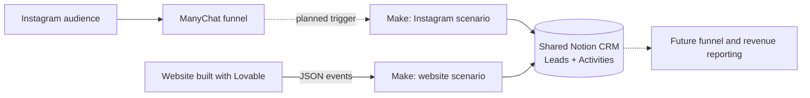
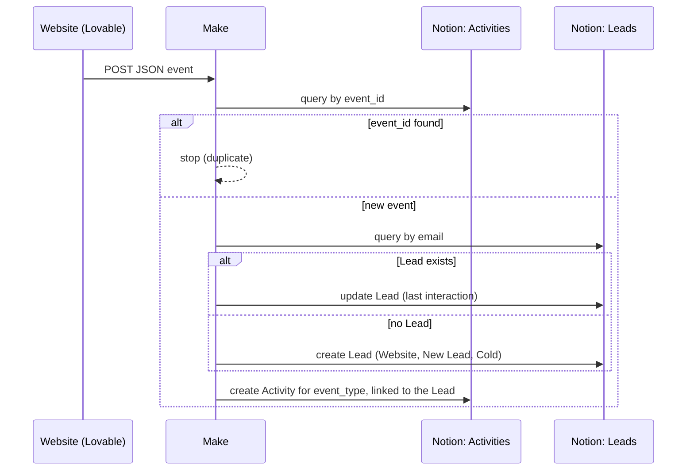
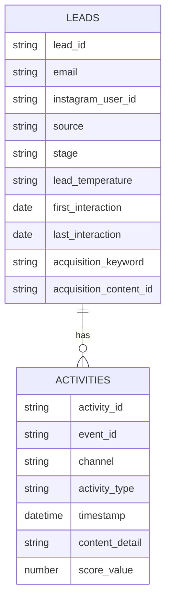

# Architecture, event contract and data model

## 1. Where this engine sits



## 2. Scenario flow



**Routing.** After the Lead step, each branch (existing Lead / new Lead) has its own router with exact-match filters on `event_type`. That makes six Activity modules in total, three per branch, configured identically.

| `event_type` | Activity Type | Content detail stored |
|---|---|---|
| `signup` | Website Signup | — |
| `checkout_started` | Checkout Started | level, package, months, amount, currency, add-ons |
| `purchase_completed` | Purchase | level, package, months, amount, currency, add-ons, order ID |

Every Activity also stores: Activity ID = `event_id`, Channel = Website, Event ID, Timestamp = the event's own timestamp (falling back to processing time only if missing), Score Value, and the relation to the Lead.

## 3. Event contract

Synthetic examples. Fields shared by all events: `event_type`, `event_id`, `email`, `timestamp`.

**Signup**
```json
{
  "event_type": "signup",
  "event_id": "signup_demo_0001",
  "email": "person@example.com",
  "name": "Example Person",
  "language": "en",
  "country": "GB",
  "marketing_email_consent": false,
  "timestamp": "2026-01-15T12:00:00Z"
}
```

**Checkout started**
```json
{
  "event_type": "checkout_started",
  "event_id": "checkout_demo_0001",
  "email": "person@example.com",
  "level": "example_level",
  "package": "three_months",
  "months": 3,
  "amount": 149,
  "currency": "EUR",
  "selected_addons": ["addon_a", "addon_b"],
  "timestamp": "2026-01-15T12:05:00Z"
}
```

**Purchase completed**
```json
{
  "event_type": "purchase_completed",
  "event_id": "purchase_demo_0001",
  "email": "person@example.com",
  "level": "example_level",
  "package": "three_months",
  "months": 3,
  "amount": 149,
  "currency": "EUR",
  "selected_addons": ["addon_a"],
  "order_id": "ORDER-DEMO-0001",
  "timestamp": "2026-01-15T12:10:00Z"
}
```

`event_id` identifies a delivered event and is used for deduplication; `order_id` identifies the underlying order. They serve related but distinct purposes.

## 4. CRM data model (shared with the Instagram engine)

Simplified view: key fields only.



- **Leads** are people; **Activities** are lifecycle events and touchpoints.
- A website Lead starts as source Website, stage New Lead, temperature Cold. Its signup, checkout and purchase events then build its history as Activities.
- Original acquisition fields are never overwritten on update, so a person who first arrived from Instagram keeps that attribution.
